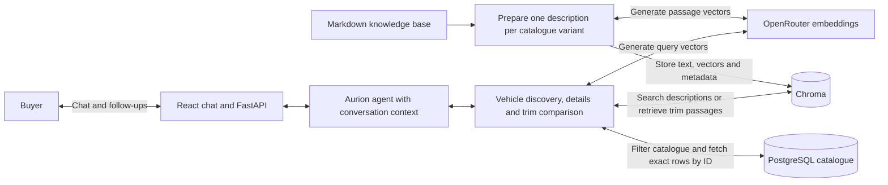
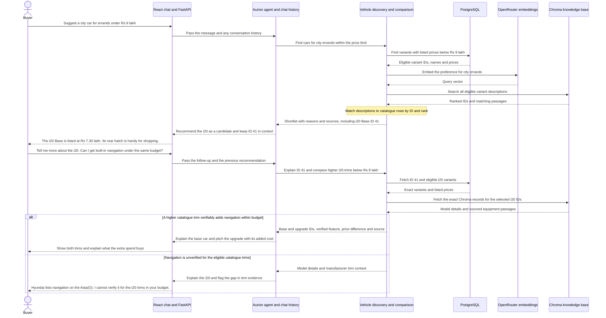

# Aurion RAG

Aurion searches vehicle descriptions across the full catalogue, uses a vehicle ID to fetch the exact variant and listed price from PostgreSQL, and uses the knowledge base to explain why the car fits. When a higher trim adds a feature the buyer cares about, Aurion can show it alongside the original pick and explain the price difference.

### Component architecture



**Build the index.** The indexer reads the model descriptions and seeded variant lists in [`vehicle_knowledge.md`](../app/RAG/documents/vehicle_knowledge.md). Each variant gets one record, such as `vehicle:41` for Hyundai i20 Base. Its searchable text combines the shared model description, exact trim identity, and any confirmed equipment for that trim. Chroma keeps manufacturer comparisons as reference text alongside the description. Rebuild the index after updating the knowledge base or adding catalogue variants to it.

**Find and explain vehicles.** For a recommendation, embed the buyer's preferences and search the descriptions for all eligible variants. If the buyer gives a budget, brand, or body-type constraint, PostgreSQL supplies the eligible IDs first. With no such filters, Chroma can search the full catalogue and the service can fetch the top IDs from PostgreSQL afterward. Rank by relevance, group near-identical trims so they do not crowd out other models, and fetch relevant passages for the shortlist. For a follow-up about a specific car, use its ID to limit retrieval to its trim and applicable model passages. PostgreSQL supplies the exact catalogue identity, body type, and listed price. The KB supplies sourced descriptions and equipment details.

**Compare a higher trim when it helps.** Look for higher trims in the same model's documented lineup. Retrieve the feature evidence for both variants so Aurion can explain what the buyer would gain. Verify that the feature is an addition and retrieve both listed prices by ID to calculate the difference. Offer the upgrade when it addresses a stated preference and fits the buyer's budget. If evidence links a feature only to a manufacturer trim whose catalogue mapping is unknown, Aurion can mention it as manufacturer context and say that the equipment for the listed trim is unverified. A must-have needs evidence for the exact variant before Aurion can call it a match.

### One conversation from recommendation to trim comparison

This walkthrough uses the Hyundai i20 to illustrate a possible search result. The guide links Hyundai's navigation feature to manufacturer trims such as Asta(O), while the seeded catalogue uses labels such as Base and S. The upgrade branch shows what Aurion can say once the KB verifies that an exact catalogue trim adds the feature.



### When RAG starts and how a chat turn works

**Before the chat**, start Chroma and run the indexing command from the project root.

```powershell
python -m app.RAG.ingestion.index_vehicle_knowledge
```

The indexer sends each variant description to OpenRouter. The embedding model turns each description into a vector, a list of numbers that lets Chroma compare text by meaning. Chroma stores the vector alongside the text and vehicle ID. A complete index for the same description revision is reused. Restart the backend after rebuilding so it loads the new revision. [Index build](../app/RAG/retrieval/chroma_vehicle_knowledge.py#L52)

**During the chat**, RAG starts when the chat model calls `recommend_vehicles`. Starting the app makes the tool available. Retrieval happens when the tool needs evidence for the buyer's request.

For **“Recommend a hatchback under ₹9 lakh that's easy to park”**, the turn works like this.

1. **The chat model reads the message.** It calls `recommend_vehicles` with `easy to park` as a preference and hatchback and budget as catalogue filters.
2. **PostgreSQL finds eligible cars.** It returns the exact variants, IDs, and listed prices that satisfy the filters.
3. **OpenRouter embeds the preference, and Chroma retrieves descriptions.** Chroma compares the vector for `easy to park` with the stored description vectors for eligible IDs. One possible hit is the Glanza, whose description mentions extra parking camera views on upper grades.
4. **The recommendation service checks and ranks the matches.** It verifies that each description belongs to the exact catalogue variant, drops weak matches, and returns up to three cars with their prices, descriptions, and sources. A reference to upper grades gives the buyer context for comparison.
5. **The chat model writes the answer.** It uses those tool results to explain the recommendations. This is the generation part of retrieval-augmented generation. [Recommendation service](../app/RAG/recommendations/recommendation_service.py#L26)

“List hatchbacks under ₹9 lakh” uses PostgreSQL alone. For a firm requirement such as “It must be automatic,” the recommendation tool looks up the exact `automatic` topic and requires confirmed evidence for the exact trim. Similarity helps rank preferences. Confirmation is what qualifies a variant for a must-have. [Tool routing](../app/prompts/vehicle_assistant.md#L51) · [Required-topic lookup](../app/RAG/retrieval/chroma_vehicle_knowledge.py#L123)

### Documenting a verified trim upgrade

Use the catalogue variant's Markdown bullet to record its documented position in the lineup. Append `· Trim rank 1` for the lower trim and its verified rank for the higher trim. Under the same model, add a `### Verified catalogue equipment` section. Each bullet uses the format below. The IDs, equipment and URLs here are fictional examples.

```markdown
- **ID 901 · built_in_navigation · absent**. The Base specification omits built-in navigation. [Source](https://example.com/base)
- **ID 902 · built_in_navigation · present**. The Plus specification lists built-in navigation. [Source](https://example.com/plus)
```

The comparison tool checks both exact variants, trim order and listed prices. A missing equipment entry means the feature is unverified. The current guide provides manufacturer context but does not yet establish exact catalogue trim equipment and ranks, so new upgrade pitches need that evidence first.

### 1. `documents/` — Source material

| File | Responsibility |
|---|---|
| [vehicle_knowledge.md](/D:/workspace/playground/Agentic-Vehicle-Sales-Assistant-/app/RAG/documents/vehicle_knowledge.md) | Contains the model descriptions and manufacturer feature comparisons for 200 seeded variants. Each variant gets a searchable record based on its catalogue ID. |
| [vehicles.json](/D:/workspace/playground/Agentic-Vehicle-Sales-Assistant-/app/RAG/documents/vehicles.json) | Contains five sample vehicle records. The current RAG pipeline has no reader for this file. Vehicle IDs, prices, and inventory filters come from PostgreSQL. |

### 2. `ingestion/` — Read and validate the evidence

| File | Responsibility |
|---|---|
| [vehicle_knowledge.py](/D:/workspace/playground/Agentic-Vehicle-Sales-Assistant-/app/RAG/ingestion/vehicle_knowledge.py) | `VehicleKnowledge` turns each model description and variant bullet into a `KnowledgeEntry`. It checks for conflicting IDs, duplicate variants and duplicate verified equipment for a variant. |
| [index_vehicle_knowledge.py](/D:/workspace/playground/Agentic-Vehicle-Sales-Assistant-/app/RAG/ingestion/index_vehicle_knowledge.py) | The entry point for `python -m app.RAG.ingestion.index_vehicle_knowledge`. It loads configuration, reads the parsed entries, calls Chroma’s `build()` method, and reports how many records were indexed. |

### 3. `embeddings/` — Turn text into vectors

| File | Responsibility |
|---|---|
| [embedding_service.py](/D:/workspace/playground/Agentic-Vehicle-Sales-Assistant-/app/RAG/embeddings/embedding_service.py) | `OpenRouterEmbeddings` sends text to the configured embedding model and returns a vector of 2,048 numbers for each input. It checks response order, vector size and values. Indexing uses `passage` mode for descriptions. Recommendation retrieval uses `query` mode for buyer preferences. |

The embedding client generates vectors. Chroma handles storage and search.

### 4. `retrieval/` — Store and search the evidence

| File | Responsibility |
|---|---|
| [chroma_vehicle_knowledge.py](/D:/workspace/playground/Agentic-Vehicle-Sales-Assistant-/app/RAG/retrieval/chroma_vehicle_knowledge.py) | `build()` stores each description, its vector, and its metadata under an ID such as `vehicle:41`. `semantic_matches()` searches by cosine similarity, optionally restricted to eligible catalogue IDs. `entries_for_ids()` powers vehicle details, verified requirements and trim comparisons. |

Chroma persists the evidence vectors in the Docker volume `aurion_chroma_data`. PostgreSQL holds the vehicle inventory in a separate database. [Docker Compose](/D:/workspace/playground/Agentic-Vehicle-Sales-Assistant-/docker-compose.yml)

### 5. `recommendations/` — Decide what to show

| File | Responsibility |
|---|---|
| [recommendation_service.py](/D:/workspace/playground/Agentic-Vehicle-Sales-Assistant-/app/RAG/recommendations/recommendation_service.py) | `RecommendationService` applies inventory filters and firm requirements, asks the retriever for evidence, drops weak matches, and checks the vehicle identity against PostgreSQL. It ranks up to three vehicles by preference match, then price and ID, and returns the supporting reasons and sources. |

The root `app/RAG/__init__.py` and each code folder’s `__init__.py` mark Python packages and describe their purpose. They contain no pipeline logic. Outside `app/RAG`, [agent_tools.py](/D:/workspace/playground/Agentic-Vehicle-Sales-Assistant-/app/tools/agent_tools.py:32) connects the recommendation service to the assistant’s `recommend_vehicles` tool.
