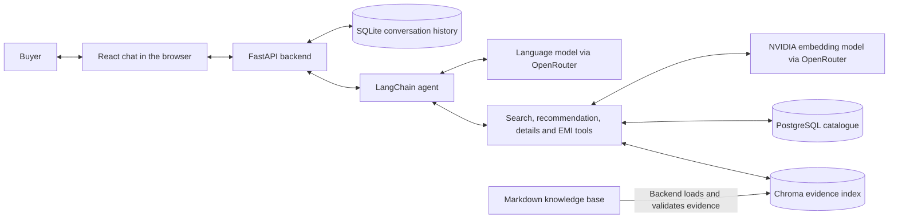
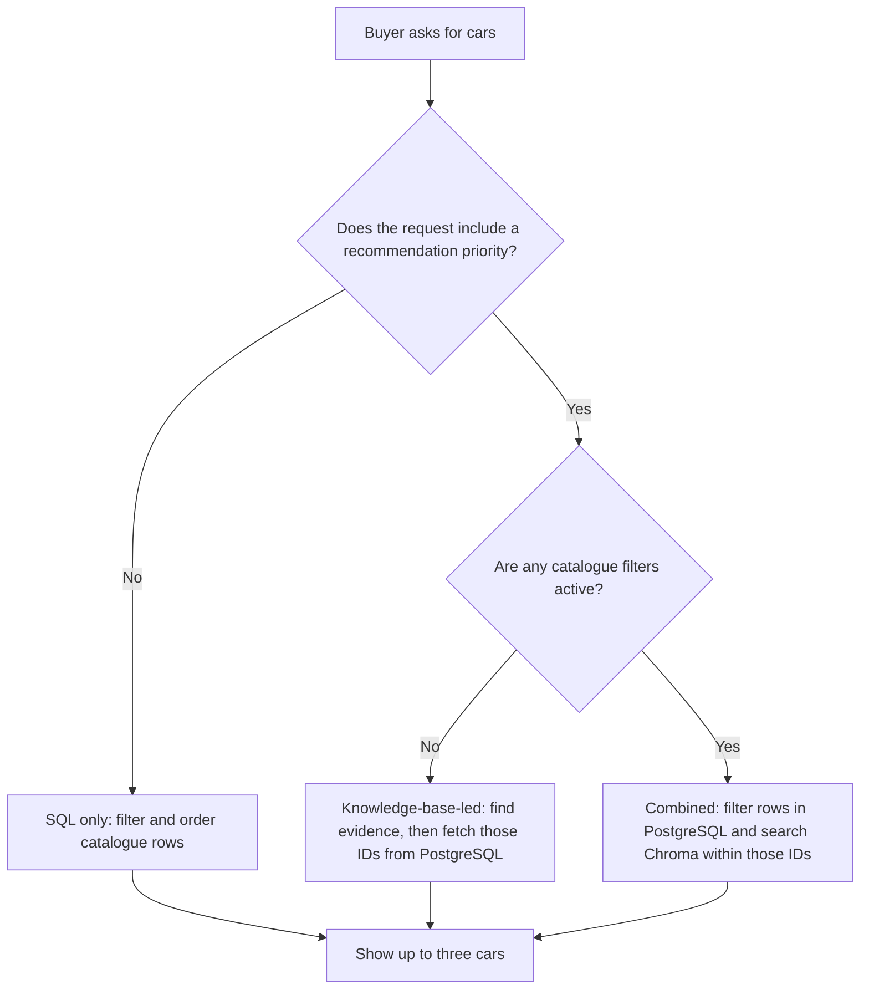
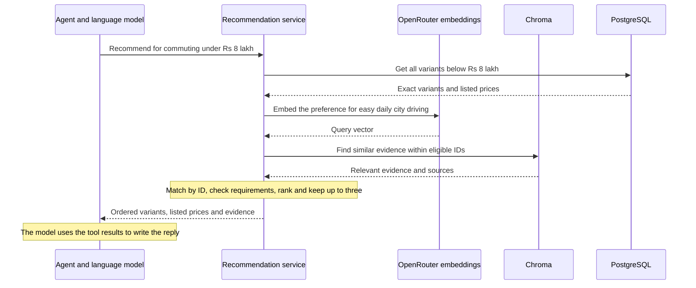

# How Aurion works

Aurion is a chat assistant for car buyers in India. It can find cars in a catalogue, suggest variants for needs such as city commuting, and calculate monthly loan payments. When it recommends a car, it uses two kinds of information. PostgreSQL supplies the exact variant and listed price. A knowledge base supplies sourced reasons to consider that variant.

## The parts of the system

| Part | What it does |
|---|---|
| React chat | Sends your message and shows the reply as it arrives. |
| FastAPI | Accepts chat requests, loads the right conversation and sends results back to the browser. The browser normally uses `POST /api/chat/stream`. The API also offers `POST /api/chat` for a complete reply in one response. |
| LangChain agent | Coordinates the work. It gives the language model the chat history and a list of tools. When the model asks for a tool, the backend runs that function and gives the model the result. |
| OpenRouter | Connects the backend to the language model. The model interprets the buyer's wording, chooses tools and writes the reply. |
| PostgreSQL | Stores the catalogue. Each row has a vehicle ID, brand, model, variant where available, body type and listed price in rupees. A variant is a specific version of a model, such as Swift Base. |
| Chroma | Searches the embeddings of Markdown evidence. An embedding is a list of numbers that lets the app compare text by meaning. Each passage keeps its topic, variant ID and source. |
| SQLite | Stores completed web chat turns and tool results. This lets Aurion reuse a shortlist when the buyer asks about “the second one.” |

[Docker Compose](../docker-compose.yml) runs PostgreSQL and Chroma in separate containers with persistent storage. The [README](../README.md) covers local setup.

You can also chat from the terminal with `python main.py`. It uses the same agent and tools and keeps its history for that terminal session.

## How Aurion chooses a search

A **catalogue filter** is a field PostgreSQL can check directly, such as maximum price, brand or body type. A **recommendation priority** describes what the buyer wants from a car, such as ease of parking. The agent uses the current message and relevant earlier messages to decide which route to take.

| Buyer asks | What happens |
|---|---|
| “Show me cars under ₹8 lakh.” | `search_vehicles` uses PostgreSQL. Every row that meets the filters is eligible regardless of evidence coverage. A broad search shows distinct models and orders them by listed price by default. |
| “Suggest cars that are easy to park.” | `recommend_vehicles` embeds the parking preference, searches Chroma for passages with similar meaning, then fetches the matching PostgreSQL records in one batch. |
| “Suggest an easy commuter under ₹8 lakh.” | `recommend_vehicles` asks PostgreSQL for every variant under the price ceiling. It searches for passages similar to the commuting preference within those eligible IDs. |

If the buyer first asks for an easy commuter and then says “under ₹8 lakh,” the commute priority still applies. If they say “forget commuting, just show me cars under ₹8 lakh,” the search uses the catalogue filters alone. Questions about a specific ID can use `get_vehicle_details`. Loan estimates use `calculate_emi` with the buyer's loan amount, interest rate and repayment period.

## How retrieval-augmented generation works here

**RAG** stands for **retrieval-augmented generation**. The app retrieves relevant information first and passes it to the language model so it can write an answer grounded in that information.

### Preparing the knowledge base

The source file is [`app/RAG/documents/vehicle_knowledge.md`](../app/RAG/documents/vehicle_knowledge.md). Each row in its recommendation evidence table records a vehicle ID, its exact variant identity, a topic such as `commuting`, a reason and a source. Evidence is marked **confirmed** when the source verifies the criterion for that exact variant, or **indicative** when it supports considering the variant and leaves the criterion unverified.

Run `python -m app.RAG.ingestion.index_vehicle_knowledge` to validate the Markdown and build the Chroma collection for that revision. The command sends the public evidence text to OpenRouter's NVIDIA Nemotron embedding model and saves the returned vectors. After editing the Markdown, rebuild the index and restart the backend. During a recommendation, the chat model rewrites the buyer's preferences as short vehicle-only phrases. The backend embeds those phrases with the same model, and Chroma finds passages with similar meaning. Firm requirements still use exact, confirmed evidence.

### Following a recommendation request

Here is the combined route for “Suggest an easy commuter under ₹8 lakh.”

1. The agent extracts an easy-city-driving preference and a maximum listed price of ₹7,99,999, since “under ₹8 lakh” is a strict bound in whole rupees.
2. The backend checks that the evidence belongs to the exact catalogue variant. An ID missing from PostgreSQL is dropped. For a combined search, every eligible variant can be considered before the shortlist is cut to three.
3. Firm requirements are checked before ranking. “Automatic only” requires confirmed transmission evidence for the exact variant. “Automatic preferred” affects ranking and leaves otherwise eligible cars in the running.
4. The backend ranks eligible variants by similarity in the buyer's priority order. A cutoff calibrated on example queries filters weak matches. Listed price and vehicle ID break ties. When evidence is weak across the shortlist, Aurion asks a focused follow-up before showing cars.
5. The model receives the ordered list, including prices, reasons and sources. A car within budget whose commute suitability is still unverified is described as a **budget match**. The backend saves the completed web chat turn with the ordered tool results for follow-up questions.

For example, the seed catalogue lists **Maruti Suzuki Swift Base**, ID **131**, at **₹6,50,000**. PostgreSQL supplies that price. The Markdown points to its hatchback body style as a reason to consider it for city driving. That evidence is indicative, so the reply can describe it as a budget match and explain what makes it worth considering. The pilot covers commuting, parking, luggage and selected body-style preferences. An automatic-only request needs confirmed transmission evidence to produce a match.

## What happens when a search cannot finish

Aurion distinguishes between zero catalogue matches, weak recommendation evidence and firm requirements it cannot verify. A PostgreSQL, Chroma or embedding service outage is reported as a temporary failure. Catalogue-only searches can still use PostgreSQL when Chroma or the embedding service is unavailable.

For web chat, `APP_ENV=prod` applies a seven-request session cap over 24 hours. `APP_ENV=dev` disables that session cap for local testing.

## Where to find the implementation

| Area | File |
|---|---|
| Web chat and streaming | [`app/api/routes/chat.py`](../app/api/routes/chat.py) |
| Agent and search instructions | [`app/agents/agent.py`](../app/agents/agent.py), [`app/prompts/vehicle_assistant.md`](../app/prompts/vehicle_assistant.md) |
| Recommendation rules and ranking | [`app/RAG/recommendations/recommendation_service.py`](../app/RAG/recommendations/recommendation_service.py) |
| Markdown loading and indexing | [`app/RAG/ingestion/`](../app/RAG/ingestion/) |
| Embedding client | [`app/RAG/embeddings/`](../app/RAG/embeddings/) |
| Chroma storage and retrieval | [`app/RAG/retrieval/`](../app/RAG/retrieval/) |
| Catalogue queries | [`app/repositories/postgres_vehicle_repository.py`](../app/repositories/postgres_vehicle_repository.py) |
